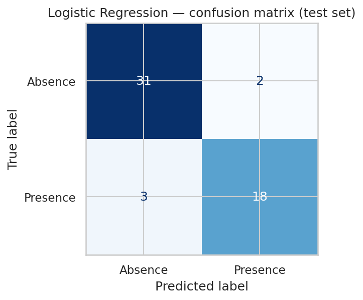

# Heart Disease Risk Prediction with Machine Learning

Predicting the presence of heart disease from 13 routine clinical variables, with a **prevention** goal: flag high-risk patients, including asymptomatic ones, before a cardiac event.

Group project, MSc Big Data & AI, INSEEC Grande École (2026).

  

---

## Context

Cardiovascular disease is the leading cause of death worldwide. In routine practice, risk factors are often read one by one. A model can combine all of them at once and return a risk probability.

**Research question:** can a supervised model trained on 13 clinical variables predict heart disease more reliably than single-variable assessment?

## Key results

| Model | Features | Test accuracy | Recall (disease) |
|---|---|---|---|
| **Logistic Regression** | all 13 | **0.91** | **0.86** |
| Artificial Neural Network | all 13 | 0.83 | – |
| Artificial Neural Network | 5 continuous only | 0.69 | – |



- **Logistic Regression is the retained model:** it is the most accurate, and its coefficients are readable by a clinician. That matters for trust and adoption in a medical setting.
- **Recall was the priority metric.** A false negative means a sick patient is sent home. The model identifies 18 of 21 sick patients in the test set and misses 3.
- **The ANN underperforms** on 270 patients: there is not enough data to exploit non-linear interactions.
- **Categorical features matter:** removing them drops ANN accuracy from 0.83 to 0.69. Thal, number of major vessels and chest pain type carry much of the signal.
- **Asymptomatic patients** (chest pain type 4) show the lowest maximum heart rate under effort. This is the silent risk profile a screening model is best placed to detect.

## Dataset

**Statlog (Heart)**, UCI Machine Learning Repository (via Kaggle): 270 patients, 13 features, no missing values.

| Group | Variables |
|---|---|
| Demographic | age, sex |
| Cardiac performance under effort | max heart rate, oldpeak (ST depression), ST slope, exercise-induced angina |
| Clinical & diagnostic | chest pain type, resting blood pressure, cholesterol, fasting blood sugar, resting ECG, major vessels, thal |

See [`data/README.md`](data/README.md) to get the file.

## Method

1. **Exploratory analysis**: distributions, correlation heatmap, scatterplots (continuous variables) and boxplots (categorical variables), coloured by diagnosis.
2. **Logistic Regression**: 80/20 split, standardisation, confusion matrix, coefficient analysis, 5-fold stratified cross-validation, decision-threshold analysis to reduce false negatives.
3. **Artificial Neural Network** (Keras): 2 hidden layers of 20 ReLU neurons, sigmoid output, trained on all features and then on continuous features only.
4. **K-Means clustering** (k = 3) on standardised features to look for natural patient groups. The clusters overlap heavily: risk appears as a continuum rather than as distinct profiles.

## Repository structure

```
heart-disease-prediction/
├── notebooks/
│   └── heart_disease_prediction.ipynb   # full analysis, runnable end to end
├── data/
│   └── README.md                         # where to get dataset_heart.csv
├── figures/                              # charts generated by the notebook
├── requirements.txt
└── README.md
```

## Run it

```bash
git clone https://github.com/<your-username>/heart-disease-prediction.git
cd heart-disease-prediction
pip install -r requirements.txt
# put dataset_heart.csv in data/
jupyter notebook notebooks/heart_disease_prediction.ipynb
```

The notebook also runs on Google Colab (it falls back to Google Drive if `data/` is empty).

## Limitations

- **Small sample** (270 patients): results depend on the train/test split. Cross-validation is included to measure stability.
- **Gender imbalance**: about two thirds of patients are men, so performance may be lower for women. Any clinical use would require validation on a balanced, recent population.
- **Old, single-source dataset**: limited generalisability.
- **Basic ANN**: no dropout or early stopping.

## Ethics

The dataset is anonymised and was used for academic purposes only, following GDPR principles. No attempt at re-identification was made. This model is a decision-support prototype, not a diagnostic tool.

## Team

Ketsia Kemougne · Rim Blila · Chaima Maouche · Linda Bouroumi · Kenza Bouteboub

**My contribution:** _[to complete: e.g. exploratory analysis and visualisations, Logistic Regression and evaluation, ANN, literature review, report writing]_

## Tech stack

Python · pandas · NumPy · Matplotlib · Seaborn · scikit-learn · TensorFlow/Keras · Jupyter / Google Colab
